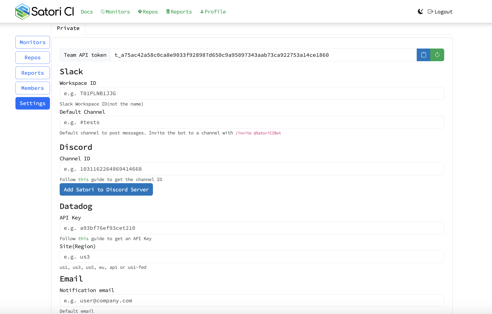
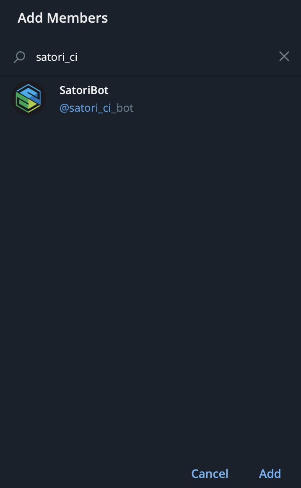
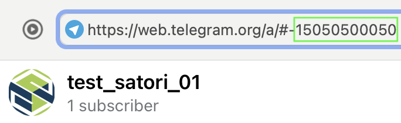

# Notifications

Personal notification defaults are configured with `satori-v2 settings` (or the web [dashboard](https://www.satori.ci/dashboard/) Settings page). The same command also manages GitHub PAT and AI credentials — see [Other settings](#other-settings). Playbook `settings.notify`, `satori-v2 run --notify`, and `satori-v2 search --notify` send to Slack, email, Discord, and Telegram. The older playbook keys `log` / `logOnFail` / `logOnPass` are not used by v2 — migrate to `settings.notify`.

Our flexible notification system ensures that your team stays informed about the status of your projects in real-time. We offer integration with multiple communication platforms, including:

- [Slack](#slack)
- [Discord](#discord)
- [Email](#email)
- [Telegram](#telegram)
- [Datadog](#datadog)

You can define the specific conditions under which you wish to receive updates—whether on test failures, successes, or both.

## User notification defaults

Store personal defaults with `satori-v2 settings` (backed by `GET` / `PATCH /settings` under `notify`):

| Key | Purpose |
| --- | --- |
| `default` | Preferred platform: `slack`, `email`, `discord`, or `telegram` |
| `slack_workspace` | Slack team ID (`T…`) |
| `slack_channel` | Channel ID or `#name` |
| `email` | Address |
| `discord` | Channel ID |
| `telegram` | Chat ID |

When a notify rule’s `to` is incomplete — bare `slack` / `email` / `discord` / `telegram` / `default`, empty `scheme://`, or a Slack URI missing workspace and/or channel — the server fills those values from the job owner’s defaults (finish and issue-status notify) or the authenticated caller’s defaults (`search --notify`). Full URIs are left unchanged. Destinations that still cannot be completed are skipped.

## Notification settings

You can configure notifications using either the web interface or the CLI.

### Via CLI

Use [`satori-v2 settings`](#satori-v2-settings) described below.

### Via Web 

You can also set up notifications using the web interface by completing the necessary fields in the Notifications section of the Satori web [dashboard.](https://www.satori.ci/dashboard/)

1. Log in to the Satori web dashboard.
2. Navigate to the Settings section.
3. Fill in the required fields for your notification preferences (e.g., email, Slack, Discord, etc.).
4. Save your settings to activate notifications for your project.



## `satori-v2 settings`

Manage personal account settings: GitHub PAT, AI provider/credentials, and notification defaults (Slack, email, Discord, Telegram). There is no interactive menu and no Datadog keys.

### List all settings

```sh
satori-v2 settings
```

Prints three tables (`github`, `ai`, `notify`). Secrets (`github`, `ai.anthropic`, …) show `configured` or `(not set)`, never the raw value.

### View one key

```sh
satori-v2 settings default
satori-v2 settings email
satori-v2 settings github
satori-v2 settings ai.provider
satori-v2 settings KEY
```

**Notify keys:** `default`, `email`, `slack_workspace`, `slack_channel`, `discord`, `telegram`

**Other keys:** `github`, `ai.provider`, `ai.model_id`, `ai.anthropic`, `ai.openai`, `ai.openrouter`

### Set a notify value

```sh
satori-v2 settings default slack
satori-v2 settings email user@example.com
satori-v2 settings slack_workspace T1234567
satori-v2 settings slack_channel C1234567
satori-v2 settings discord 1234567890
satori-v2 settings telegram -1234567890
```

`default` must be one of `slack`, `email`, `discord`, or `telegram`. Empty values are rejected; use `--clear` to remove a setting.

### Clear a value

```sh
satori-v2 settings email --clear
satori-v2 settings default --clear
```

### Other settings

```sh
# GitHub PAT (also: satori-v2 config pat TOKEN)
satori-v2 settings github ghp_...
satori-v2 settings github --clear

# AI credentials and selection
satori-v2 settings ai.anthropic sk-ant-...
satori-v2 settings ai.openai sk-...
satori-v2 settings ai.openrouter sk-or-...
satori-v2 settings ai.provider anthropic
satori-v2 settings ai.model_id claude-sonnet-4-5
satori-v2 settings ai.provider --clear
satori-v2 settings ai.anthropic --clear
```

Setting `ai.provider` picks a default model from the provider’s allowed list when the current model is not valid for that provider. Clear `ai.model_id` by clearing `ai.provider` instead.

## Playbook Settings

Define when and where to notify with a `settings.notify` list. Each rule has:

| Field | Required | Description |
| --- | --- | --- |
| `result` | no | `fail` or `pass` — when the rule applies. Omitted matches both. |
| `to` | yes | Destination URI (see below) |
| `severity` | no | List of named levels. On fail, the rule matches if **any** listed level appears in the execution report. Ignored when the run passed. |
| `watch` | no | When the rule fires: `finish` (the execution finished) and/or `issue-status` (an issue changed status). Without `watch`, the rule fires on finish only. See [Watching issue status](#watching-issue-status). |

Named severities (case-insensitive): `info`, `low`, `medium`, `high`, `critical`, `blocker`.

### Destination URIs

| Scheme | Format | Notes |
| --- | --- | --- |
| Slack | `slack://WORKSPACE:CHANNEL` or `slack://WORKSPACE/CHANNEL` | Channel may be a Slack channel ID (`C…`) or `#name`. Invite `@SatoriCIBot` to the channel. **Sending is supported.** |
| Email | `email://user@example.com` | Sent from `info@satori.ci` via Satori's Gmail integration. **Sending is supported.** |
| Discord | `discord://CHANNEL_ID` or `discord://GUILD/CHANNEL_ID` | Channel ID from Discord Developer Mode. Invite the Satori bot to the server/channel (see [Discord](#discord)). **Sending is supported.** |
| Telegram | `telegram://CHAT_ID` or `telegram://bot:chat` | Chat/channel ID (often negative, e.g. `-15050500050`). Invite `@satori_ci_bot` (see [Telegram](#telegram)). **Sending is supported.** |
| Short form | `slack`, `email`, `discord`, `telegram`, `default`, or empty `scheme://` | Expanded from the user's `PATCH /settings` `notify` defaults at send time. |

Multiple rules are allowed. Matching Slack, email, Discord, and Telegram destinations are notified at the end of each finished execution (and on issue-status events when `watch` includes `issue-status`). Messages include pass/fail, fail counts, severity summary, and links to the job and report on `https://dashboard.satori.ci`.

### Example

```yml
settings:
  notify:
    - result: fail
      severity: [high, critical, blocker]
      to: slack://T00000000:C00000000
    - result: fail
      severity: [high, critical, blocker]
      to: email://security@example.com
    - result: fail
      severity: [high, critical, blocker]
      to: discord://123456789012345678
    - result: fail
      severity: [high, critical, blocker]
      to: telegram://-15050500050
    - result: pass
      to: slack://T00000000:C11111111
```

Use saved user defaults (no workspace/channel in the playbook):

```yml
settings:
  notify:
    - result: fail
      to: slack
```

Notify on any failure (no severity filter):

```yml
settings:
  notify:
    - result: fail
      to: slack://T00000000:C00000000
```

Notify on finish regardless of pass or fail:

```yml
settings:
  notify:
    - to: slack://T00000000:C00000000
```

### Watching issue status

`watch` lists the events that fire a rule:

| `watch` | Sent when |
| --- | --- |
| omitted | the execution finishes |
| `[finish]` | the execution finishes |
| `[issue-status]` | an issue is marked True Positive / TP (not on finish) |
| `[issue-status, finish]` | both |

An `issue-status` event happens when an issue (finding) of the execution is marked True Positive (`TP`), for example after `satori-v2 issue <id> status TP` or `satori-v2 issue <id> verify`. Other status changes (FP, investigating, etc.) do not notify. For these events:

- `result` is checked against the execution the issue belongs to.
- `severity` is checked against the **issue's** severity, not the report totals. An issue without a severity does not match a rule that sets `severity`.
- To avoid repeated messages on every run, the new status is compared with the last triaged status (anything but `OPEN`) of the same issue in an earlier execution of the same repository and playbook. If it's the same, nothing is sent.

```yml
settings:
  notify:
    - watch: [issue-status]
      result: fail
      severity: [blocker, critical, high]
      to: slack://T00000000:C00000000
    - watch: [issue-status]
      result: fail
      severity: [blocker, critical, high]
      to: email://security@example.com
    - watch: [issue-status]
      result: fail
      severity: [blocker, critical, high]
      to: discord://123456789012345678
    - watch: [issue-status]
      result: fail
      severity: [blocker, critical, high]
      to: telegram://-15050500050
```

The message includes the issue title, the old and new status, the severity, the repository and a link to the report.

### CLI override: `--notify`

On `satori-v2 run`, `--notify` is repeatable. When present, the CLI rules **replace** playbook `settings.notify` for that run (they do not merge).

```sh
satori-v2 run ./ \
  --notify 'severity=blocker,critical,high,result=fail,to=slack://T00000000:C00000000' \
  --notify 'result=pass,to=slack://T00000000:C11111111' \
  --notify 'result=fail,to=email://security@example.com' \
  --notify 'result=fail,to=discord://123456789012345678' \
  --notify 'result=fail,to=telegram://-15050500050'
```

Each value is a comma-separated `key=value` string:

- Required: `to=<uri>`
- Optional: `result=pass|fail` (omitted matches both)
- Optional: `severity=blocker,critical,high` (comma-separated levels until the next key)
- Optional: `watch=issue-status,finish` (either or both; defaults to finish only, see [Watching issue status](#watching-issue-status))
- `status=…` is accepted but ignored

Notify only when a blocker, critical or high issue is marked True Positive:

```sh
satori-v2 run ./ --repo owner/repo \
  --notify 'watch=issue-status,severity=blocker,critical,high,result=fail,to=slack://T00000000:C00000000'
```

See also [Run command options](modes/run.md#execution-environment).

### Search: `--notify`

On `satori-v2 search`, `--notify` is repeatable and takes a bare Slack, email, Discord, or Telegram URI (`slack://workspace:channel`, `email://user@example.com`, `discord://CHANNEL_ID`, or `telegram://CHAT_ID`). It is **not** a job rule: the API sends the **current page** of search results as a monospace table (Id, Playbook source, Status, Result, Created at), and still prints the table in the terminal.

```sh
satori-v2 search --playbook satori://code/python/pyspector.yml \
  --notify slack://T00000000:C00000000 \
  --notify email://security@example.com \
  --notify discord://123456789012345678 \
  --notify telegram://-15050500050
```

- Requires an authenticated session (anonymous search cannot notify)
- Empty result pages are not sent
- Invalid URIs fail the request with an error; delivery failures are best-effort and do not hide the listing
- Does not apply to `--download`, `--reports`, `--stop`, or `--delete`

See also [Search](modes/executions.md#search).

### Legacy keys

`log`, `logOnFail`, and `logOnPass` (channel type names without URIs) are **not** applied by CLI v2. Prefer `settings.notify` with explicit `to` URIs.

## Configuring Notifications

### Email

To set up email notifications, use this command:

```sh
satori-v2 settings email your@email.com
```

### Slack

To set up Slack notifications in Satori, follow these steps to retrieve your workspace and channel IDs:

Steps to Retrieve Workspace and Channel ID:

1. Open the web version of Slack and navigate to the channel you're interested in.
2. In your browser’s URL bar, you’ll see a URL like this: https://app.slack.com/client/T00000000/C00000000. The part after '/client/' is split into two segments.
3. In the Satori CI dashboard, go to Settings.
4. Enter the first segment of the URL (e.g., T00000000) in the workspace ID field.
5. Insert the Channel ID (e.g., C00000000) in the default channel field to receive notifications.
6. Select Add Satori to Workspace and follow the instructions on the Slack website to add the bot.
7. In Slack, invite the bot to the channel by typing `/invite @SatoriCIBot.`

Or via the CLI command: 

```sh
satori-v2 settings slack_workspace TXXXXXXXXXX
satori-v2 settings slack_channel CXXXXXXXXXX
```

### Discord

To set up Discord notifications in Satori, you first need to obtain the Channel ID. Follow these steps:

**Enabling Developer Mode:**
1. Open your Discord settings by clicking the gear icon in the bottom left corner, next to your username and avatar.
2. In the settings menu, select Appearance under the App Settings category.
3. Scroll down to the Advanced section and toggle on Developer Mode.

**Obtaining the Channel ID:**
1. Right-click the desired channel name in Discord.
2. Select Copy ID from the dropdown menu. The Channel ID is now copied to your clipboard.
*Note: This method can be used to obtain IDs for text channels, voice channels, categories, and individual messages.*

Once you have the Channel ID, use it in playbook `settings.notify` (or `satori-v2 run --notify`) as `discord://CHANNEL_ID`. Invite the Satori Discord bot to your server first:

https://discord.com/api/oauth2/authorize?client_id=1038196776752128131&permissions=2048&scope=bot

You can also configure a default channel in Satori Web or with the following command:

```sh
satori-v2 settings discord CHANNEL_ID
```

### Telegram

To set up Telegram notifications with Satori, follow these steps:

1. Create a Telegram Channel: ensure you have a Telegram channel and invite the `@satori_ci_bot` to it.


2. Obtain the Channel ID: access your channel via the web at Telegram Web. The Channel ID is the number that appears after the # in the URL (e.g., -15050500050).
Once you have the Channel ID, use it in playbook `settings.notify` (or `satori-v2 run --notify`) as `telegram://CHAT_ID` (include the leading minus for channels). Invite `@satori_ci_bot` to the channel first.


You can also configure a default channel:

```sh
satori-v2 settings telegram CHANNEL_ID
```

### Datadog

Datadog delivery is handled by the platform notification service. User notification defaults (`satori-v2 settings` / `PATCH /settings` `notify`) and playbook `settings.notify` rules do **not** currently support Datadog destinations — configure Slack, email, Discord, or Telegram instead.

## Report notifications

To receive a copy of your test report in PDF format along with your notifications, you can specify this in your **Playbook Settings**.

```yml
settings:
  notify:
    - result: fail
      to: slack://T00000000:C00000000
  report: pdf
```

If you wish to prevent the generation of any reports, you can set the report option to false. This will ensure that all generated outputs are deleted:

```yml
settings:
  notify:
    - result: fail
      to: slack://T00000000:C00000000
  report: false
```
